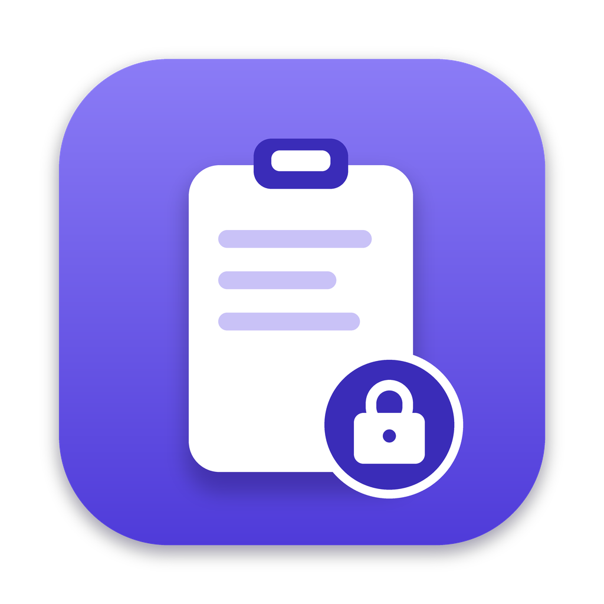
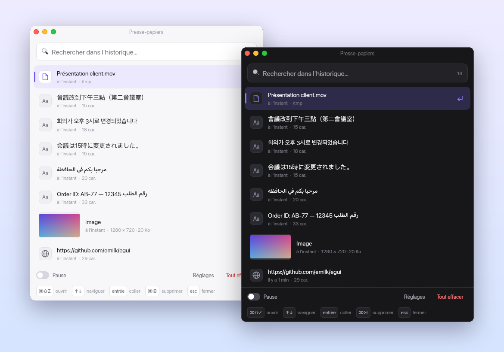
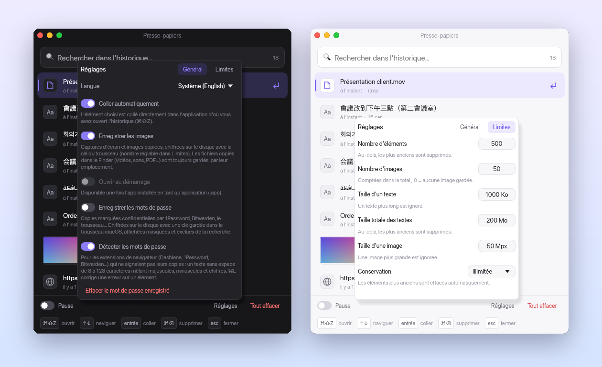
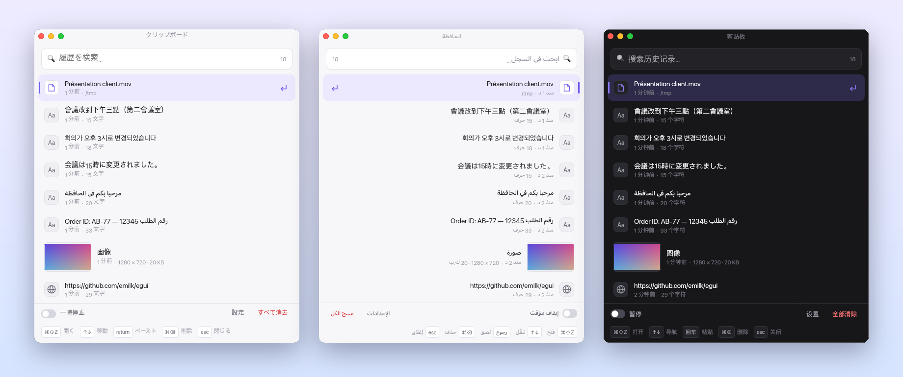

<div align="center">



# CopyQ-rs

**L'historique du presse-papiers pour Mac qui ne garde jamais vos mots de passe en clair.**

Tout ce que vous copiez — textes, captures, fichiers — à portée de **⌘⇧Z**, collé là où vous en étiez.
Natif, rapide, chiffré, et rien ne quitte votre Mac.

[](https://github.com/aloulouamine/copyq-rs/actions/workflows/screenshots.yml)
[](https://github.com/aloulouamine/copyq-rs/releases/latest)




</div>

## Pourquoi CopyQ-rs

- **⌘⇧Z, Entrée, c'est collé.** L'historique s'ouvre au-dessus de n'importe quelle app ; l'élément choisi est collé directement là où vous étiez, sans repasser par ⌘V.
- **Vos secrets restent secrets.** Les copies de 1Password, Bitwarden ou du trousseau sont ignorées. Les mots de passe copiés depuis une extension de navigateur sont repérés automatiquement. Ceux que vous choisissez de garder, comme vos images, sont chiffrés en AES-256 avec une clé rangée dans le trousseau macOS.
- **Tout ce que vous copiez, pas seulement du texte.** Captures d'écran avec vignette et aperçu, fichiers du Finder (vidéos, PDF, dossiers), liens.
- **Retrouvé en une frappe.** Recherche instantanée, sans tenir compte des accents ni de la casse, dans des milliers d'éléments.
- **Dans votre langue.** 11 langues, interface entièrement en miroir pour l'arabe, chinois, japonais et coréen avec les polices du système.
- **Léger et discret.** Écrit en Rust : le presse-papiers n'est lu que lorsqu'il change, la base vit dans son propre thread, l'interface ne bloque jamais.

### Face à l'historique intégré de macOS

| | Historique de macOS (Spotlight) | CopyQ-rs |
| --- | --- | --- |
| Durée de conservation | 7 jours maximum | Illimitée, ou de 1 jour à 1 an |
| Mots de passe d'extensions de navigateur | Enregistrés comme du texte ordinaire | Repérés, masqués, chiffrés ou ignorés |
| Images sur le disque | — | Chiffrées (AES-256-GCM) |
| Collage direct dans l'app d'origine | — | Oui |
| Limites de taille et de nombre réglables | — | Oui |

## Installation

**[⬇ Télécharger la dernière version (.dmg)](https://github.com/aloulouamine/copyq-rs/releases/latest)** — macOS 13 Ventura ou plus récent, Mac Apple Silicon et Intel.

1. Ouvrez le `.dmg` et glissez **CopyQ-rs** dans **Applications**.
2. Lancez l'app. Tant que les versions ne sont pas notarisées par Apple, macOS bloque le premier lancement : ouvrez **Réglages Système → Confidentialité et sécurité** et cliquez sur **Ouvrir quand même**.
3. Autorisez CopyQ-rs dans **Réglages Système → Confidentialité et sécurité → Accessibilité** pour le collage direct. Sans cette autorisation, l'élément est copié et il reste à faire ⌘V.

Ensuite : copiez quelque chose, appuyez sur **⌘⇧Z**, choisissez avec **↑ ↓** et validez avec **Entrée**.

<details>
<summary>Compiler depuis les sources</summary>

```bash
# Rust requis : https://rustup.rs
cargo build --release
bash ci/make_app.sh target/release/copyq-rs CopyQ-rs.app   # app signée ad hoc, avec icône
open CopyQ-rs.app
```

Pour essayer sans empaqueter : `cargo run --release`.

</details>

## Raccourcis

| Touches | Action |
| --- | --- |
| **⌘⇧Z** | Ouvrir l'historique, ou le masquer s'il est au premier plan (fonctionne en AZERTY, QWERTZ…) |
| **↑ / ↓** | Se déplacer dans la liste |
| **Entrée** ou clic | Coller l'élément dans l'app d'origine |
| **⌘⌫** | Supprimer l'élément sélectionné |
| **⌘L** | Marquer ou démarquer un élément comme mot de passe |
| **Échap** | Vider la recherche, puis masquer la fenêtre |

## Réglages

<div align="center">

</div>

- **Général** : langue, collage automatique, enregistrement des images, ouverture au démarrage, enregistrement et détection des mots de passe.
- **Limites** : nombre d'éléments (500 par défaut), d'images (50), taille d'un texte (1 000 Ko), taille totale (200 Mo), taille d'une image (50 Mpx), durée de conservation (illimitée par défaut). **Appliquer** indique d'abord combien d'éléments seront supprimés ; **Valeurs par défaut** restaure les réglages d'origine.
- **Pause**, en bas de la fenêtre, arrête l'enregistrement le temps d'une copie sensible.

## 11 langues, y compris de droite à gauche

<div align="center">

</div>

Anglais, français, allemand, espagnol, italien, portugais (Brésil), japonais, coréen, chinois simplifié et traditionnel, arabe. Par défaut, la langue de macOS ; modifiable dans **Réglages → Général → Langue**.

En arabe, toute l'interface passe de droite à gauche. Un texte arabe copié s'affiche dans le bon sens quelle que soit la langue choisie, même mêlé de latin ou de chiffres. Les chemins et les dimensions restent lisibles de gauche à droite. Des tests vérifient, avec les vraies polices du Mac, l'ordre des glyphes dans chaque langue.

## Sécurité et confidentialité

- **Aucun accès réseau** : l'historique reste sur votre Mac.
- **Mots de passe ignorés par défaut** : les copies marquées confidentielles ou temporaires (convention [nspasteboard.org](http://nspasteboard.org)) ne sont ni lues ni enregistrées.
- **Détection des mots de passe d'extensions** (Dashlane, 1Password, Bitwarden…, qui copient sans marqueur) : un texte sans espace de 8 à 128 caractères mêlant majuscules, minuscules et chiffres est traité comme un mot de passe. Les éléments déjà enregistrés sont rattrapés au lancement.
- **Chiffrement** : si vous choisissez de garder les mots de passe, ils sont chiffrés en AES-256-GCM, affichés masqués (••••) et exclus de la recherche. Images et vignettes sont chiffrées avec une sous-clé de la même clé, liée à leur nom. La clé de 256 bits vit dans le **trousseau macOS** (service `com.amine.copyq-rs`) ; doublons et suppressions passent par une empreinte HMAC-SHA256.
- **Jamais en clair** : si le trousseau est inaccessible, un mot de passe reste en mémoire et une image n'est pas gardée. Les données en clair des anciennes versions sont chiffrées au lancement.

## Où sont mes données ?

| Quoi | Où |
| --- | --- |
| Historique (base [Turso](https://github.com/tursodatabase/turso)) | `~/Library/Application Support/com.amine.copyq-rs/history.db` |
| Images chiffrées (`.png.enc`) | `~/Library/Application Support/com.amine.copyq-rs/images/` |
| Réglages | `~/Library/Application Support/com.amine.copyq-rs/settings.json` |
| Journal | `~/Library/Logs/copyq-rs/copyq-rs.log` |

Les fichiers copiés depuis le Finder sont gardés par leur emplacement, pas copiés ; ils sont signalés « introuvable » s'ils ont été déplacés.

## Feuille de route

- [ ] Exclure certaines applications de l'historique
- [ ] Épingler des favoris
- [ ] Coller en texte brut
- [ ] Raccourci global configurable
- [ ] Mode barre des menus seule (sans icône dans le Dock)

## Développement

```bash
cargo test                # tests unitaires
cargo clippy -- -D warnings
cargo fmt --check
```

Chaque `git push` lance sur un Mac GitHub (macOS 14) : formatage et Clippy, tests unitaires, tests de bout en bout avec le vrai presse-papiers (`ci/e2e.py`), auto-test de l'app empaquetée (`ci/bundle_selftest.sh`) et captures d'écran dans plusieurs langues et thèmes. Résultats sur la branche `ci-results`.

**Publier une version** : mettre à jour `version` dans `Cargo.toml`, puis lancer **Actions → Release → Run workflow** en cochant *publier* (ou pousser un tag `vX.Y.Z`). Le workflow `release.yml` compile un binaire universel, construit `CopyQ-rs-X.Y.Z.dmg`, le vérifie et publie la release. Avec les secrets `MACOS_CERT_P12`, `MACOS_CERT_PASSWORD`, `APPLE_ID`, `APPLE_TEAM_ID` et `APPLE_APP_PASSWORD`, l'app est signée Developer ID et notarisée.

Les images de ce README sont composées à partir de ces captures : `python3 ci/readme_shots.py <shots> docs/screenshots` (la CI les dépose aussi dans `shots/readme/`).

<details>
<summary>Architecture du code</summary>

| Fichier | Rôle |
|---|---|
| `src/main.rs` | Démarrage, fenêtre eframe |
| `src/history.rs` | Historique en mémoire, recherche, limites, import de l'ancien JSON |
| `src/storage.rs` | Base Turso dans un thread dédié (seul module à faire du SQL) |
| `src/clipboard.rs` | Surveillance du presse-papiers, encodage des images en arrière-plan |
| `src/pasteboard.rs` | Accès NSPasteboard : compteur, types, filtre des mots de passe |
| `src/media.rs` | Images : PNG, vignettes, empreintes, fichiers chiffrés |
| `src/paste.rs` | Collage automatique (app d'origine, ⌘V simulé) |
| `src/crypto.rs` | Chiffrement AES-256-GCM (mots de passe, fichiers) et empreintes HMAC |
| `src/keychain.rs` | Clé de chiffrement dans le trousseau macOS |
| `src/i18n.rs`, `locales/` | Traductions (11 langues), détection de la langue, ordre bidirectionnel |
| `src/settings.rs` | Réglages persistants (`settings.json`) |
| `src/logging.rs` | Journal fichier, gestion des panics, verrous récupérables |
| `src/single_instance.rs` | Instance unique (verrou + socket Unix) |
| `src/login_item.rs` | Ouverture au démarrage (`SMAppService`) |
| `src/app/mod.rs` | Interface egui : état, recherche, pied de page, raccourcis clavier |
| `src/app/row.rs` | Lignes de la liste : aperçu, icône, vignette, actions |
| `src/app/settings_panel.rs` | Panneau Réglages (Général, Limites) |
| `src/app/widgets.rs` | Composants (interrupteur, touches, texte bidirectionnel) |
| `src/icons.rs` | Icônes vectorielles |
| `src/theme.rs` | Thème clair / sombre (suit macOS), polices système par écriture |
| `src/hotkey.rs` | Raccourci global ⌘⇧Z |
| `src/keyboard.rs` | Trouve la touche « Z » selon la disposition (AZERTY, QWERTZ…) |
| `src/tray.rs` | Icône et menu de la barre des menus |
| `src/platform.rs` | Afficher/masquer via `NSApplication` sur macOS |

</details>

---

<sub>Inspiré de [CopyQ](https://hluk.github.io/CopyQ/), le gestionnaire de presse-papiers multiplateforme. Écrit en Rust avec [egui](https://github.com/emilk/egui).</sub>
